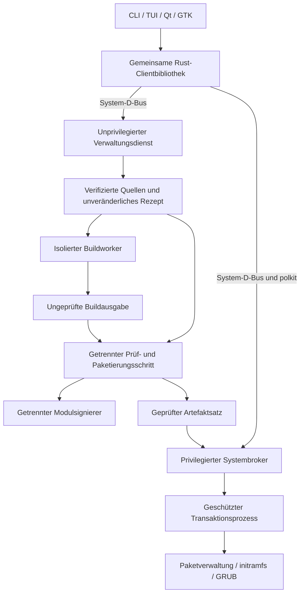

# MyMainline – Architektur, Sicherheitsentscheidungen und Implementierungsroadmap

Stand: 9. Oktober 2026. Status: vereinbarter Entwurf, noch nicht implementiert. Machbarkeitsnachweise und unabhängiges Architekturreview stehen aus.

Navigation: [Projektübersicht](../README.md) · [Recherche](research/README.md) · [Entscheidungen](adr/README.md) · [Prüfmatrix](validation.md) · [Roadmap](ROADMAP.md).

## 1. Ziel, Umfang und festgelegte Grundlagen

Dieser Plan legt Produktumfang, Vertrauensgrenzen, Wiederherstellungsverfahren, Nachweis eines Rückfallkernels, Schlüsselverwaltung, Konfigurationspolitik und Authentifizierung ohne Desktop fest. Die Verzeichnisstruktur und Schnittstellen beschreiben die geplante Anwendung; dieses Repository enthält zunächst ausschließlich ihre Dokumentation.

### Produktziel

MyMainline erkennt offizielle Upstream-Kernel, überprüft deren Herkunft, erstellt nachvollziehbare Buildrezepte und baut daraus distributionspassende Pakete. Installation, Testboot, dauerhafte Übernahme und Entfernung erfolgen als getrennte, ausdrücklich freizugebende Vorgänge.

Die Anwendung soll auf einem produktiv genutzten Desktop entwickelt werden können. Entwicklungsbetrieb und Kernelbuilds erhalten deshalb keinen Schreibzugriff auf dessen Bootumgebung. Installations- und Fehlerprüfungen finden zunächst ausschließlich in Wegwerf-VMs statt.

### Verbindliche Entscheidungen

| Bereich | Festlegung |
|---|---|
| Projekt | Eigenständige Neuentwicklung |
| Repository | Öffentlich: [bdgraue/MyMainline](https://github.com/bdgraue/MyMainline) |
| Anwendungscode | GPL-3.0-only als Planungsdefault; Drittkomponenten behalten ihre Lizenzen |
| Backend | Rust |
| Kernelbuild | Direkte Orchestrierung der offiziellen Kconfig-/Kbuild-Verfahren |
| TuxMake | Referenz, keine Laufzeitabhängigkeit |
| Erste Zielsysteme | Ubuntu/Kubuntu 26.04 und Debian 13 |
| Erste Architektur | x86_64/amd64 |
| Oberflächen | CLI, TUI, Qt und GTK, getrennt installierbar |
| Qt | Qt 6/QML mit CXX-Qt |
| GTK | GTK 4 mit gtk-rs |
| Buildausführung | Unprivilegierte Sandbox mit distributionspassender Buildumgebung |
| Integrationstests | QEMU-VMs |
| Standardprofil | Kompatibel |
| Standardkanal | Stable; aktive Longterm-Reihen separat auswählbar |
| Installation | Ausschließlich nach Freigabe eines konkreten Systemplans |
| Neustart | Eigene, separate Freigabe |
| Kernel-Patches | Keine im Standardverfahren |

### Einordnung bestehender Projekte

[Mainline](https://github.com/bkw777/mainline) verwaltet fertige Ubuntu-Mainline-Pakete und verwendet Vala/GTK. Sein Bedienkonzept und seine Paketzuordnung sind hilfreiche Referenzen. Eine eigene Buildpipeline, mehrere Distributionen und vier Clients würden jedoch große Architekturänderungen erfordern. Das Repository enthält die [GPLv3-Lizenz](https://github.com/bkw777/mainline/blob/master/LICENSE).

[linux-tkg](https://github.com/Frogging-Family/linux-tkg) bietet umfangreiche Kernelanpassungen und Paketierung. Seine vorhandenen Hosteingriffe und Konfigurationsentscheidungen werden nicht übernommen.

[TuxMake](https://tuxmake.org/cli/) bietet etablierte Buildautomatisierung einschließlich Debian-Paketierung. MyMainline übernimmt die Verantwortung für seine eigene, kleinere Orchestrierung und verwendet direkt die offiziellen Kernelverfahren.

**Es wird zunächst kein Anwendungscode dieser Projekte kopiert.** Übernommene Hilfsprogramme oder Vorlagen müssen mit Herkunft, Version und Lizenz dokumentiert werden.

### MVP und vollständiger ursprünglicher Funktionsumfang

Der erste vollständige Anwendungsrelease wird als **v0.1** bezeichnet. Er enthält alle vier Clients, aber eine bewusst begrenzte Systemintegration.

| Fähigkeit | v0.1 | Nachfolgender Ausbau |
|---|---|---|
| Stable-/Longterm-Erkennung, Quellenprüfung | Vollständig | Weitere Archivzugänge |
| Konfiguration und drei Profile | Vollständig innerhalb der unterstützten Sicherheitsregeln | Weitere Optimierungen |
| Image, Module und Header | Debian-Pakete für beide Zielsysteme | Weitere Paketfamilien |
| DKMS, initramfs, Kernelverwaltung | Vollständig für die geprüften Plattformprofile | Weitere Integrationen |
| Testboot und Rückfall | GRUB | Weitere Bootverfahren |
| Versionsprüfung, optionaler Autobuild | Vollständig | Weitere Kanäle |
| CLI, TUI, Qt, GTK | Alle vier | Weitere Komfortfunktionen |
| Release Candidates | Optional anzeigen; kein RC-Buildpfad | Verifizierter RC-Buildpfad |
| Secure Boot | Erkennen und Installation sicher sperren | Vollständige Kernel-/Modulsignierung und Einschreibung |

Damit erfüllt v0.1 noch nicht jede ursprüngliche Anforderung vollständig. Insbesondere RC-Builds und vollständige Secure-Boot-Unterstützung bleiben eigene Ausbaustufen.

### Plattformgrenzen

Für v0.1 werden folgende Installationskonstellationen freigegeben:

- Ubuntu/Kubuntu 26.04 und Debian 13.
- amd64.
- GRUB und initramfs-tools.
- BIOS oder UEFI mit deaktiviertem Secure Boot.
- Unverschlüsselte ext4-System-/Bootumgebung auf gewöhnlichen Partitionen; eine separate EFI-Systempartition ist zulässig.

LUKS, LVM, RAID, Btrfs-Bootumgebungen, UKIs und andere Bootloader benötigen zusätzliche Integrationstests. Auf zunächst nicht unterstützten Systemen bleiben Quellenprüfung, Build und Export verfügbar; Systemänderungen werden gesperrt.

Fedora und Arch sind die nächsten Distributionsziele. openSUSE folgt als Untersuchungskandidat. Ein vorhandenes Paketierungsziel genügt nicht als Unterstützungsnachweis: [Kbuild-Paketierungsverfahren](https://github.com/torvalds/linux/blob/master/scripts/Makefile.package).

---

## 2. Architektur und verbindliche Sicherheitsentscheidungen

### 2.1 Prozesse und Verantwortlichkeiten



Die Rollen verwenden getrennte Berechtigungen:

| Rolle | Darf | Darf nicht |
|---|---|---|
| Clients | Anzeigen, planen, Aktionen anfordern | Rootkommandos ausführen, Sicherheitsregeln umgehen |
| Verwaltungsdienst | Downloads, Rezepte, Jobs und Ereignisse verwalten | Bootumgebung oder Paketdatenbank verändern |
| Buildworker | Verifizierte Eingaben verarbeiten, Kandidaten erzeugen | Netzwerk, Host-Bootpfade, Dienstzustand oder private Schlüssel erreichen |
| Prüf-/Paketierungsprozess | Kandidaten prüfen und kontrolliert paketieren | Worker-Skripte oder Worker-Hilfsprogramme ungeprüft ausführen |
| Modulsignierer | Freigegebene Moduldateien eines bekannten Rezepts signieren | Beliebige Dateien signieren oder private Schlüssel ausgeben |
| Systembroker | Autorisierte Systempläne prüfen und starten | Beliebige Shellkommandos oder Benutzerpfade ausführen |
| Transaktionsprozess | Einen geschützten Plan ausführen und protokollieren | Ungeplante Paketaktionen oder Neustarts durchführen |

Buildworker erhalten keine Schreibrechte auf Zustandsdaten, Schlüssel oder geprüfte Artefakte. Die ausführenden Rollen dürfen nicht allein durch unterschiedliche Prozessnamen desselben ungeschützten Arbeitsverzeichnisses getrennt sein.

### 2.2 ADR: Vertrauensmodell für Buildausgabe und Installation

**Entscheidung:** Buildausgabe ist zunächst ein ungeprüfter Kandidat. Der Rootbroker installiert ausschließlich Artefakte, die den getrennten Prüf- und Paketierungsschritt durchlaufen haben.

Zum Vertrauensmodell gehören:

- Das vorhandene Hostsystem einschließlich Rootadministration.
- MyMainline-Verwaltungs-, Prüf-, Signier- und Brokerprogramme.
- Die festgeschriebene Toolchain und deren authentifizierte Pakete.
- Die akzeptierten Upstream-Unterzeichner.
- Die vorhandenen Distributionshooks und administrativ installierten DKMS-Quellen.

Die Sandbox begrenzt Schäden während des Builds. Sie beweist nicht, dass ein erzeugter Kernel frei von Schadcode oder Fehlern ist. Auch eine Quellensignatur beweist keine fehlerfreie Übersetzung. Reproduktionsprüfungen liefern zusätzliche Evidenz; sie ersetzen keine unabhängige Vertrauenswurzel.

Der Prüf-/Paketierungsschritt muss:

1. Quellen- und Rezeptherkunft aus der geschützten Eingabeablage beziehen.
2. Architektur, Kernelrelease, Paketnamen und Dateimanifest überprüfen.
3. Pfadüberschreitungen, gefährliche Links, Spezialdateien, Setuid-/Setgid-Dateien und unerwartete Dateifähigkeiten ablehnen.
4. Paketmetadaten und Maintainer-Skripte aus projektseitig gepflegten Vorlagen erzeugen.
5. Ungeprüfte Worker-Maintainer-Skripte vollständig verwerfen.
6. Ausführbare Header-Buildlogik und benötigte Hosthilfsprogramme aus verifizierten Quellen und dem freigegebenen Rezept rekonstruieren.
7. Verbleibende Builddaten wie Symbolinformationen strukturiert prüfen.
8. Einen unveränderlichen Artefaktsatz mit vollständigem Manifest erzeugen.

Die Headerprüfung ist notwendig, weil externe Modulbuilds deren Makefiles, Skripte und Hilfsprogramme verwenden. Ein Headerpaket ist kein reines Textarchiv. Grundlage: [Upstream-Headerpaketierung](https://github.com/torvalds/linux/blob/master/scripts/package/install-extmod-build).

Der Broker übernimmt geprüfte Artefakte aus einer ausschließlich für den Prüfprozess beschreibbaren Ablage. Er prüft die Identität dieses Prozesses, kopiert die Dateien in seine eigene geschützte Ablage und kontrolliert dort erneut Hashes und erlaubte Metadaten. Die anschließende Installation verwendet ausschließlich diese Kopien.

**v0.1 akzeptiert keine beliebigen importierten `.deb`-Dateien zur privilegierten Installation.** Bestehende fremde Kernel bleiben inventarisierbar und unter den Schutzregeln entfernbar.

### 2.3 ADR: Autorisierung und ausdrückliche Zustimmung

Der Broker bestimmt den tatsächlichen D-Bus-Absender selbst. Übermittelte Benutzerkennungen gelten nicht als Berechtigungsnachweis.

Ein `SystemPlan` bindet:

- Besitzer.
- Aktion und ausgewählte Pakete.
- Artefakthashes.
- Plattformprofil.
- Relevanten Paket- und Bootzustand.
- Erwartete Änderungen.
- Rückfallkernel.
- Sicherheitsregeln.
- Ablaufzeit und Planhash.

Pläne sind 15 Minuten gültig, einmalig ausführbar und werden unmittelbar vor Ausführung erneut geprüft. Ein bereits gestarteter Vorgang wird durch den Ablauf dieser Frist nicht abgebrochen.

Installation, Entfernung, Testboot, dauerhafter Standardwechsel und Neustart sind getrennte Aktionen. Eine erfolgreiche Autorisierung darf keine andere Aktion freigeben.

Die Anwendung liefert polkit-Aktionsdefinitionen mit Administratorauthentifizierung aus. Sie installiert keine pauschalen Regeln, die Benutzergruppen dauerhaft ohne Prüfung berechtigen. Temporär gespeicherte Autorisierung wird im Standardverfahren nicht verwendet. Grundlage: [polkit-Autorisierungsmodell](https://polkit.pages.freedesktop.org/polkit/polkit.8.html).

### 2.4 ADR: CLI und TUI ohne Desktop

CLI und TUI verwenden dieselben D-Bus-Schnittstellen und benötigen keine eigene Rootausführung.

Für Terminal und SSH gilt:

1. Einen vorhandenen Desktopagenten gegebenenfalls nutzen.
2. Bei verfügbarem Terminal einen textuellen Agenten mit `pkttyagent` registrieren.
3. Den Agenten an die tatsächliche D-Bus-Verbindung binden.
4. Seine erfolgreiche Registrierung abwarten.
5. Erst danach eine interaktive Autorisierung anfordern.
6. Den Agenten nach Ende des Autorisierungsvorgangs beenden.

Die dokumentierten Optionen `--system-bus-name`, `--notify-fd` und `--fallback` ermöglichen diesen Ablauf: [pkttyagent](https://polkit.pages.freedesktop.org/polkit/pkttyagent.1.html).

Ohne Terminal und ohne ausreichende Autorisierung scheitert die Aktion mit `AuthenticationRequired`. Es gibt keinen stillen Wechsel zu `sudo` und keinen dauerhaft privilegierten CLI-Modus.

Ein ausdrücklich bestätigter Plan kann über eine nichtinteraktive Schnittstelle angefordert werden. Fehlende Autorisierung bleibt dabei ein Fehler. Automatische Installationsketten gehören nicht zu v0.1.

### 2.5 Technologie und Module

| Bereich | Auswahl |
|---|---|
| Backend / CLI | Rust, Tokio, clap |
| Kommunikation | System-D-Bus über zbus |
| Downloads | reqwest mit rustls |
| Datenmodelle | Serde |
| Persistenz | SQLite über rusqlite |
| Quellenprüfung | GnuPG mit dediziertem Projekt-Schlüsselbund |
| Build | Kconfig/Kbuild |
| Isolation | bubblewrap und systemd-Ressourcenbegrenzung |
| Buildumgebung | mmdebstrap mit expliziten Archivschlüsseln |
| TUI | Ratatui und Crossterm |
| Qt | Qt Quick Controls, QML, CXX-Qt |
| GTK | GTK 4, gtk-rs |
| Systemtests | QEMU |

Qt benötigt weder Kirigami noch GTK; GTK benötigt weder libadwaita noch Qt. CXX-Qt enthält generierten C++-Brückencode. Die konkrete Bibliothekskombination wird für beide Zielplattformen festgeschrieben.

Die fachlichen Module sind:

- **Domain:** unveränderliche Rezepte, Rollen, Pläne und Zustandsübergänge.
- **Sources:** Katalog, Downloads und Vertrauensanker.
- **Config:** Basiskonfiguration, Profile und Sicherheitsprüfung.
- **Build:** Isolation, Ressourcen, Kbuild und Abbruch.
- **Artifacts:** Prüfung, Headeraufbereitung, Signierung und Paketierung.
- **Platform:** Paket-, initramfs- und Bootintegration.
- **System:** Autorisierung, Transaktionen und Wiederherstellung.
- **Client:** gemeinsame Kommunikation und Präsentationsdaten.

Ubuntu und Debian teilen Debian-Paketierungslogik. Unterschiede bei Konfiguration und Integration werden ausdrücklich getestet. Paketformat, initramfs-Verfahren und Bootloader bleiben eigenständige Adapter.

### 2.6 Öffentliche Schnittstellen und Begriffe

Vorgesehener Namensraum: `io.github.bdgraue.MyMainline`, mit versionierten D-Bus-Interfaces `Manager1` und `System1`.

| Typ | Verbindliche Bedeutung |
|---|---|
| `BuildRecipe` | Unveränderliche, vollständig aufgelöste Buildvorgabe |
| `BuildJob` | Ein Ausführungsversuch dieses Rezepts |
| `ArtifactSet` | Geprüfte Pakete und zugehörige Nachweise |
| `SystemPlan` | Konkrete, zeitlich begrenzte Änderung des Zielsystems |
| `BootObservation` | Beobachteter Start mit Bootkennung und Kernelidentität |
| `KnownGoodKernel` | Technisch zugeordneter und vom Benutzer bestätigter funktionierender Kernel |
| `CapabilityReport` | Unterstützte Aktionen einschließlich nachvollziehbarer Sperrgründe |
| `OperationError` | Stabiler Fehlercode, Kontext und möglicher nächster Schritt |

Die Interfaces unterstützen Releaseabfrage, Rezeptvorbereitung, Buildjobs, Reproduktion, Artefaktexport, Inventar sowie Vorbereitung und Ausführung von Systemplänen.

Lang laufende Aktionen liefern Jobkennungen. Ereignisse erhalten Sequenznummern; Wiederverbindung liest den tatsächlichen Zustand neu. Ein wiederholter Aufruf mit derselben Operationskennung liefert den vorhandenen Vorgang und startet keine zweite Installation.

CLI-Ausgaben sind sowohl menschenlesbar als auch als versioniertes JSON verfügbar. Ein angenommener Auftrag wird ausdrücklich als angenommen angezeigt, nicht als bereits erfolgreich abgeschlossen.

---

## 3. Verifizierte und reproduzierbare Buildpipeline

### 3.1 Quellen und Vertrauensanker

Der [kernel.org-Katalog](https://www.kernel.org/releases.json) dient zur Versionserkennung. Er wird nicht als signierte oder vollständige historische Datenbank behandelt.

Ablauf:

1. Zulässigen Releasekanal und Herkunft bestimmen.
2. Archiv und Entwicklersignatur herunterladen.
3. Weiterleitungen, Größenlimits und Vollständigkeit prüfen.
4. Das unkomprimierte Tar-Archiv kryptografisch verifizieren.
5. Unterzeichner gegen den Projekt-Schlüsselbund prüfen.
6. Erst danach sicher entpacken.

kernel.org signiert das unkomprimierte Archiv; Prüfsummen ersetzen die Entwicklersignatur nicht: [offizielles Signaturverfahren](https://www.kernel.org/category/signatures.html).

Der Schlüsselbund enthält vollständige Fingerprints und dokumentierte Herkunft. Unbekannte oder widerrufene Schlüssel werden abgelehnt. Schlüsseländerungen erfolgen über geprüfte Projektaktualisierungen, nicht durch automatische Übernahme beliebiger Serverantworten.

Der Signaturstatus und die Aktualität des Releasekatalogs werden getrennt angezeigt. Ein authentischer älterer Kernel wird nicht allein durch eine gültige Signatur zum neuesten Kernel.

### 3.2 Basiskonfiguration und Sicherheitsregeln

Standardquelle ist die Konfiguration des laufenden Kernels. Andere installierte Konfigurationen oder importierte Dateien werden ausdrücklich ausgewählt.

Jedes Rezept speichert Basiskonfiguration, Profilfragmente, Kconfig-Ergebnis und sämtliche Differenzen. Unbekannte oder verschwundene Optionen dürfen nicht stillschweigend verschwinden.

Für v0.1 gelten drei Klassen:

| Klasse | Beispiele | Behandlung |
|---|---|---|
| Geschützte Sicherheitseigenschaften | Aktive LSMs, AppArmor, Seccomp, KASLR, Speicherhärtung, erzwungene Modulsignierung | Abschwächung oder ungeklärter Verlust blockiert die Installationsfreigabe |
| Boot- und Betriebsanforderungen | Rootdateisystem, Speichercontroller, initramfs, EFI bei UEFI, notwendige Treiber | Fehlende Unterstützung blockiert die Installationsfreigabe |
| Sonstige Änderungen | Neue Treiber, nicht sicherheitskritische Defaults, Desktopprofil | Vollständig anzeigen und im Rezept bestätigen |

Die erste Sicherheitsregelmenge umfasst insbesondere vorhandene Einstellungen für:

`CONFIG_SECURITY`, `CONFIG_SECURITY_APPARMOR`, `CONFIG_LSM`, `CONFIG_SECCOMP`, `CONFIG_SECCOMP_FILTER`, `CONFIG_RANDOMIZE_BASE`, `CONFIG_STACKPROTECTOR_STRONG`, `CONFIG_STRICT_KERNEL_RWX`, `CONFIG_STRICT_MODULE_RWX`, `CONFIG_HARDENED_USERCOPY`, `CONFIG_FORTIFY_SOURCE`, `CONFIG_MODULE_SIG` und `CONFIG_MODULE_SIG_FORCE`.

Ein vorhandener Wert wird nicht pauschal durch einen Projektdefault ersetzt. Änderungen an LSM-Auswahl und Reihenfolge benötigen eine ausdrückliche Bewertung.

Fehlende Werkzeugunterstützung darf nicht zum Abschalten etwa von BTF oder Sicherheitsfunktionen führen. Der Build scheitert mit einer konkreten fehlenden Voraussetzung.

Öffentliche Distributionszertifikate werden aus authentifizierten Distributionsquellen bezogen. Fehlende Zertifikatspfade werden nicht geleert. Kann eine notwendige Distributionsfunktion im Upstream-Kernel nicht erhalten werden, wird der Konflikt benannt und die Installation gesperrt.

**MyMainline behauptet keine vollständige Sicherheitsgleichwertigkeit zum Distributionskernel.** Der Kompatibilitätsbericht beschreibt ausdrücklich den Wechsel auf einen Upstream-Kernel.

### 3.3 Konkrete Profile

| Profil | Änderungen gegenüber der Basiskonfiguration |
|---|---|
| **Kompatibel** | Keine Leistungsänderungen; nur notwendige, dokumentierte Anpassungen für Releaseidentität, Build und kontrollierte Signierung |
| **Desktop** | `CONFIG_PREEMPT_DYNAMIC=y`, Auswahl `CONFIG_PREEMPT=y`, Auswahl `CONFIG_HZ_1000=y` |
| **Individuell** | Benutzerfragmente, begrenzt durch dieselben Sicherheits- und Installationsregeln |

Das Desktopprofil verwendet vollständige Preemption als Buildstandard und erlaubt durch dynamische Preemption spätere Laufzeitwahl. Die Symbole und Abhängigkeiten werden am ausgewählten Kernelstand geprüft. Fehlt eine Voraussetzung, wird das Profil abgelehnt und nicht still auf ein anderes Profil zurückgesetzt.

Ein vorhandenes Echtzeitprofil wird nicht automatisch abgeschaltet; eine solche Basiskonfiguration ist mit dem Standard-Desktopprofil nicht vereinbar.

Grundlagen: [Preemption-Konfiguration](https://github.com/torvalds/linux/blob/master/kernel/Kconfig.preempt), [Timerfrequenz](https://github.com/torvalds/linux/blob/master/kernel/Kconfig.hz).

Alle Profile erhalten die breite Treiberauswahl. Es gibt standardmäßig weder `localmodconfig`, CPU-spezifische Compilerflags, LTO noch Änderungen an Sicherheits-Mitigationen oder Bootparametern.

Hardwareerkennung empfiehlt Ressourcenlimits und weist auf benötigte Geräteunterstützung hin. Sie entfernt keine Treiber aufgrund momentan ungeladener Module. Leistungsverbesserungen werden gemessen, nicht zugesagt.

**Abgrenzung für v0.1:** CPU-spezifische Compilerflags und das gezielte Entfernen von Treibern gehören zunächst auch im individuellen Profil nicht zum freigegebenen Optimierungsumfang. Das ist eine konservative Umfangsentscheidung, kein grundsätzliches Verbot für spätere Versionen. `-march` kann die benötigte CPU-Befehlssatzbasis verändern; `-mtune` ist davon zu unterscheiden. Die Eignung zusätzlicher Flags für den jeweiligen Kernelbuild muss gesondert geprüft werden. Eine Momentaufnahme geladener Module deckt weder später angeschlossene Geräte noch sämtliche Boot- und Rettungspfade ab. Eine spätere Erweiterung benötigt ausdrückliche Auswahl, festgeschriebene Zielhardware, vollständige Konfigurationsdifferenzen, Boot-/Gerätetests und einen weiterhin breit kompatiblen Rückfallkernel. Siehe [ADR 0008](adr/0008-config-profiles.md), [GCC zu x86-Optionen](https://gcc.gnu.org/onlinedocs/gcc/x86-Options.html) und [Upstream-Implementierung von localmodconfig](https://github.com/torvalds/linux/blob/master/scripts/kconfig/streamline_config.pl).

### 3.4 Isolierte Buildumgebung

Für jede Plattform wird ein identifizierbares Rootfs aus authentifizierten Paketarchiven erzeugt. Eingesetzte Paketversionen und Rootfs-Hash werden archiviert.

Während des Builds gelten:

- Kein Netzwerk.
- Verpflichtende Benutzer-, Mount-, Prozess- und Netzwerkisolation.
- Keine Host-Bootpfade, installierten Module, Paketdatenbanken oder Benutzerverzeichnisse.
- Keine privaten Schlüssel oder Container-Sockets.
- Schreibzugriff ausschließlich auf den Jobarbeitsraum.
- Begrenzte CPU-, RAM-, Prozess- und Plattennutzung.
- Kein unisolierter Ersatzpfad bei fehlenden Sandboxfähigkeiten.

Standardmäßig läuft ein Build gleichzeitig und verwendet höchstens die Hälfte der logischen CPUs. Speichergrenzen und Parallelität sind einstellbar. Ressourcenfehler werden explizit gemeldet.

Kbuild baut außerhalb des Quellverzeichnisses. `bindeb-pkg` erzeugt Paketkandidaten; erst der nachfolgende kontrollierte Schritt erzeugt die freigegebenen Installationspakete.

### 3.5 ADR: Modulsignierung und Schlüsselverwaltung

**Entscheidung:** Private Schlüssel bleiben außerhalb des Buildworkers. Module werden nach dem Build in einem getrennten Signierschritt signiert.

Verfahren:

1. Für eine neue Rezeptidentität ein eigenes Modulschlüsselpaar anlegen.
2. Öffentliches Zertifikat als unveränderlichen Buildinput aufnehmen.
3. Kernel und Module ohne automatische Kbuild-Signierung bauen.
4. Die vorhandene Laufzeitprüfung und gegebenenfalls Signaturerzwingung erhalten.
5. Module endgültig aufbereiten; danach signieren.
6. Signaturen prüfen und anschließend deterministisch komprimieren und paketieren.

Dabei werden `CONFIG_MODULE_SIG_ALL=n` und ein leerer `CONFIG_MODULE_SIG_KEY` als **dokumentierter Wechsel des Buildverfahrens** verwendet. Das öffentliche Zertifikat wird über die vertrauenswürdigen Zertifikatsinputs eingebunden. `CONFIG_MODULE_SIG` und `CONFIG_MODULE_SIG_FORCE` werden dadurch nicht abgeschwächt.

Diese Änderung erscheint ausdrücklich im Konfigurationsbericht. Sie darf nicht als unveränderte Basiskonfiguration ausgegeben werden.

Die Kernel-Dokumentation beschreibt ein solches mehrstufiges Verfahren: [Reproduzierbarkeit und Modulsignierung](https://docs.kernel.org/kbuild/reproducible-builds.html).

Der Signierer:

- Verwendet einen projektseitig festgeschriebenen, aus verifizierter Quelle erzeugten Signierhelfer.
- Führt niemals einen vom Buildworker gelieferten Signierhelfer aus.
- Akzeptiert ausschließlich freigegebene Modulmanifeste.
- Speichert private Schlüssel zugriffsgeschützt unter eigener Berechtigung.
- Nimmt private Schlüssel nicht in Logs, normale Exporte oder Repositorydateien auf.
- Verwendet keine Firmware-, Host- oder vorhandenen MOK-Schlüssel.

Öffentliche Zertifikate und abgetrennte Modulsignaturen werden exportierbare Reproduktionsinputs. Der Upstream-Helfer unterstützt sowohl abgetrennte Signaturen als auch deren späteres Anfügen: [sign-file](https://github.com/torvalds/linux/blob/master/scripts/sign-file.c).

Private Schlüssel werden aufbewahrt, solange sie für installierte Kernel oder autorisierte weitere Modulsignierungen benötigt werden. Löschung erfordert, dass keine aktive Referenz mehr besteht, und eine eigene Freigabe. Rotation erzeugt eine neue Rezept-/Kernelidentität.

Eine Sperre im Signierdienst widerruft keinen bereits in einem Kernel eingebauten Schlüssel. Ein solcher Austausch erfordert einen neuen Kernel. Vollständige Secure-Boot-Schlüsselverwaltung bleibt eine spätere Phase.

### 3.6 Pakete und Reproduktionsnachweis

Freigegeben werden:

- Imagepaket einschließlich Kernelmodule.
- Passendes Headerpaket.
- Rezept, Konfiguration, Zertifikate, Signaturinputs, Manifest und Buildprotokoll.

Zusätzlich erzeugte Pakete wie `linux-libc-dev` werden nicht zur Hostinstallation ausgewählt.

Die Kernelidentität enthält eine aus dem Rezept abgeleitete Kennung. Abgeleitete Identitätsfelder werden aus der Hashberechnung ausgeschlossen, um Zirkelschlüsse zu vermeiden. Gleichnamige Pakete mit abweichendem vollständigem Rezept oder Inhalt werden nicht überschrieben.

Ein Rezept erfasst Quellen, Konfiguration, Toolchain, Rootfs, Zertifikate, Seeds, Paketierungsversion und kontrollierte Buildmetadaten. Zeitangaben werden deterministisch aus dem verifizierten Quellarchiv abgeleitet, nicht aus dem aktuellen Buildzeitpunkt.

**Verbindlicher Reproduktionsumfang:**

- Kernelimage.
- Aufbereitete unsignierte Module.
- Header einschließlich benötigter Hilfsprogramme.
- Finale Installationspakete bei Wiederverwendung derselben öffentlichen Signaturinputs.

Zwei frische Arbeitsverzeichnisse und identische archivierte Eingaben müssen bytegleiche Ergebnisse liefern. Eine Abweichung lässt die Prüfung scheitern und erzeugt einen untersuchbaren Vergleichsbericht.

Auf dem Zielsystem erzeugte initramfs-Dateien und später hinzugefügte DKMS-Module gehören nicht zur Bitidentitätszusage der ursprünglichen Kernelpakete.

Die Releaseabnahme verlangt diesen Nachweis für beide Standardprofile auf beiden Distributionen. Für individuelle Rezepte gibt es eine eigene Reproduktionsoperation; ohne deren erfolgreichen Lauf erscheint kein „reproduziert“-Status.

---

## 4. Installation, Wiederherstellung und Bootwechsel

### 4.1 ADR: Pakettransaktion und Konkurrenz

**Entscheidung:** v0.1 installiert ausschließlich die konkreten lokalen Kernelpakete. Fehlende Hostabhängigkeiten blockieren den Vorgang und werden benannt; sie lösen keine ungeplante Paketauflösung oder Komplettaktualisierung aus.

Vor der Ausführung werden geschützte Artefaktkopien, Systemzustand und Planhash erneut geprüft.

Der Transaktionsprozess hält:

- Die MyMainline-Sperre für Systemänderungen.
- Eine zur Paketverwaltung kompatible Frontendsperre.
- Die erforderlichen, von dpkg selbst verwalteten Datenbanksperren während dessen Ausführung.

Für die Weitergabe einer bereits gehaltenen Frontendsperre wird der dokumentierte Mechanismus `DPKG_FRONTEND_LOCKED` verwendet. Sperrdateien werden niemals gelöscht, um eine Sperre zu umgehen: [dpkg-Schnittstelle](https://manpages.debian.org/trixie/dpkg/dpkg.1.en.html).

Nach Erwerb der Sperren erfolgt eine erneute Zustandsprüfung. Geänderte Pakete, Bootkonfigurationen oder Hooks machen einen Plan ungültig.

Die Paketoperation läuft in einem eigenen geschützten Transaktionsprozess. Ein Client- oder Verwaltungsdienstabsturz beendet diesen nicht. Ein Neustart der Steuerung darf keine zweite Paketoperation starten.

### 4.2 ADR: Dauerhafte Zustände und Recovery

Der Broker führt ein rootgeschütztes Journal. Vor jedem verändernden Schritt werden Absicht und Voraussetzungen dauerhaft gespeichert; danach folgen Ergebnis und geprüfte Nachbedingungen.

| Zustand | Bedeutung | Fehler-/Wiederanlaufverhalten |
|---|---|---|
| `Prepared` | Artefakte und Systemzustand geprüft; noch keine Systemänderung | Verwerfen möglich |
| `FallbackPinned` | Bestätigter alter Kernel als sicherer Standard festgelegt | Ohne Paketänderungen kontrolliert zurücknehmbar |
| `Installing` | Paketverwaltung aktiv | Nicht durch Clientabbruch unterbrechen |
| `InstalledUnvalidated` | Pakete vorhanden; Nachprüfungen ausstehend | Kein Testboot |
| `InstalledValidated` | Paket-, DKMS-, initramfs- und Bootprüfungen bestanden | Separater Testbootplan möglich |
| `TrialArmed` | Einmaliger Start vorbereitet | Separater Neustart; Teststart kontrolliert widerrufbar |
| `TrialObserved` | Erwarteter Kernel in neuem Boot beobachtet | Benutzerbestätigung erforderlich |
| `Promoted` | Dauerhafter Standardwechsel bestätigt und geprüft | Vorheriger Rückfallkernel bleibt geschützt |
| `RepairRequired` | Teilfehler oder ungeklärter Systemzustand | Neue Systemaktionen gesperrt; Reparaturplan erforderlich |

Beim Wiederanlauf werden Journal, Prozessidentität, Paketstatus, Dateien und Bootkonfiguration abgeglichen. Das Journal allein gilt nicht als Beweis.

**Feste Fehlerregeln:**

- Vor Paketbeginn kann abgebrochen werden.
- Während dpkg läuft, wird eine normale Abbruchanforderung vorgemerkt; dpkg wird nicht durch Schließen eines Clients getötet.
- Nach teilweiser Installation wird kein automatisches Entfernen oder blindes Wiederholen durchgeführt.
- Reparaturen betreffen ausschließlich identifizierte Pakete und benötigen einen neuen konkreten Plan.
- Fremde Paketprobleme werden nicht durch allgemeine Reparaturkommandos „mitbehoben“.
- Geänderte fremde Bootkonfigurationen werden nicht mit alten Backups überschrieben.
- Ein sicherer Fallback-Pin bleibt bestehen, solange neue Pakete die ursprüngliche Menüzuordnung beeinflussen könnten.

Debian-Paketoperationen sind keine atomaren Systemtransaktionen; insbesondere Konfigurationsfehler können teilweise konfigurierte Pakete hinterlassen. Das Wiederherstellungsmodell berücksichtigt dies ausdrücklich: [Debian Policy](https://www.debian.org/doc/debian-policy/ch-maintainerscripts.html).

### 4.3 ADR: Was als funktionsfähiger Rückfallkernel gilt

Folgende Eigenschaften werden getrennt geführt:

- Installiert.
- Aktuell laufend.
- Dauerhafter Standard.
- Technisch vollständig.
- Vom Benutzer als funktionsfähig bestätigt.

Bei der ersten Einrichtung kann nur der aktuell laufende Kernel unmittelbar als erster Rückfallkandidat bestätigt werden. Erforderlich sind:

- Eindeutige Zuordnung zu installierten Paketen.
- Vollständige Image-, Modul- und initramfs-Dateien.
- Passender Bootloadereintrag.
- Erfolgreicher aktueller Start.
- Bestätigung wesentlicher Funktionen durch den Benutzer.

Die Bestätigung umfasst mindestens Anmeldung, Anzeige, Massenspeicher und benötigte Netzwerk-/Zusatztreiber. Suspend und weitere Funktionen werden als zusätzliche, getrennte Prüfpunkte geführt.

Weicht der bisherige Standard vom bestätigten Rückfallkernel ab, muss zunächst ein eigener Plan einen sicheren Standard herstellen. Erst danach beginnt eine neue Kernelinstallation.

Ein `KnownGoodKernel` bindet Paketversionen, Dateihashes, Bootloadereintrag, Bootbeobachtung und Benutzerbestätigung. Relevante Änderungen machen den Nachweis erneut prüfpflichtig.

### 4.4 DKMS, Header und initramfs

Vor Installation werden alle vorhandenen DKMS-Module inventarisiert. In v0.1 gelten alle aktiv registrierten Module als erforderlich; ein Fehlschlag kann nicht beiläufig übergangen werden.

Vorbereitende Builds erfolgen mit den endgültigen Headern in isolierter Umgebung. Ein kleines externes Testmodul prüft zusätzlich deren allgemeine Verwendbarkeit.

`modules_prepare` allein ersetzt keinen vollständigen Kernelbuild und erzeugt insbesondere nicht die benötigten Symbolversionsdaten: [externe Kernelmodule](https://docs.kernel.org/kbuild/modules.html).

Nach der autorisierten Installation werden tatsächliche Ergebnisse geprüft:

- Pakete vollständig konfiguriert.
- Header und Kernelrelease passend.
- Alle erforderlichen DKMS-Module für den neuen Kernel vorhanden.
- Erforderliche Signaturbedingungen erfüllt.
- initramfs vorhanden und mit den benötigten Bootkomponenten aufgebaut.
- Bootloadereintrag vorhanden.
- Rückfallkernel weiterhin vollständig und erreichbar.

Neue Module werden nicht ungefragt in den laufenden Kernel geladen. Fehler verhindern den Übergang zu `InstalledValidated`.

### 4.5 GRUB-Testboot

Vor Installationshooks wird der bestätigte alte Kernel über eine stabile Eintragskennung festgelegt. Eine numerische Auswahl wie `0` wird nicht als dauerhafter Schutz akzeptiert.

Voraussetzungen:

- Unterstütztes GRUB-Plattformprofil.
- Bekannte wirksame Konfiguration.
- Verwendbarer GRUB-Umgebungsspeicher.
- Bestätigter Rückfallkernel.
- Kein ungeklärter fremder Einmalstart.
- Sichtbares Rettungsmenü mit fünf Sekunden Wartezeit während der Testphase.

Der einmalige Start wird erst nach erfolgreicher Installation und über einen eigenen Plan vorbereitet. Der alte Standard bleibt dabei bestehen.

Nach dem Neustart muss eine neue Bootkennung mit dem erwarteten Kernelrelease zugeordnet werden. Ein bloßer Dienststart oder dieselbe bereits laufende Sitzung zählt nicht als Testboot.

Bei einem anderen gestarteten Kernel bleibt der Versuch unbestätigt. MyMainline setzt ihn nicht automatisch erneut auf den nächsten Start.

Die dauerhafte Übernahme erfordert Benutzerbestätigung und einen separaten Standardwechsel. Ein hängendes System wird nicht automatisch neu gestartet; nach einem manuellen Reset muss der alte Standard wieder greifen. Dieses Verhalten wird durch echte VM-Resets nachgewiesen.

Die ursprüngliche GRUB-Konfiguration darf erst wiederhergestellt werden, wenn ihre Bedeutung geprüft ist. Insbesondere wird eine alte Auswahl `0` nicht zurückgeschrieben, solange sie inzwischen auf den neuen Kernel zeigen könnte.

### 4.6 Entfernung und Automatisierung

Innerhalb von MyMainline bleiben geschützt:

- Laufender Kernel.
- Dauerhafter Standardkernel.
- Bestätigter Rückfallkernel.
- Ausstehender Testkernel.
- Erforderliche Metapakete und Abhängigkeiten.

Unklare Paketzuordnungen verhindern die Entfernung. Es gibt kein allgemeines Autoremove und keine automatische Kernellöschung. Externe Paketmanager bleiben unabhängig; ihre Änderungen werden beim nächsten Zustandsabgleich berücksichtigt.

Versionsprüfung erfolgt standardmäßig täglich und ist abschaltbar. Automatische Builds sind zunächst deaktiviert und werden an eine freigegebene Serie, Plattform und Profilpolitik gebunden.

Neue Hauptserien oder prüfpflichtige Konfigurationsänderungen erzeugen einen Freigabebedarf. Autobuilds führen niemals zu automatischer Installation, Bootumschaltung oder Neustart.

---

## 5. Oberflächen, Projektstruktur und Roadmap

### Gemeinsames Bedienkonzept

Alle vier Clients verwenden dieselbe Clientbibliothek und dieselben Dienstoperationen. Sie bieten:

- Releases und Unterstützungsstatus.
- System- und Hardwareprüfung.
- Profile, Konfigurationsdifferenzen und Sperrgründe.
- Buildjobs, Logs und Reproduktionsnachweise.
- Artefaktexport.
- Kernelinventar und Schutzrollen.
- Konkrete Systempläne.
- Testboot, Bestätigung und Wiederherstellungsstatus.
- Automatisierungseinstellungen.

Ein Job kann in Qt gestartet und in TUI, GTK oder CLI weiter beobachtet werden. Es gibt keine clientseitig implementierte Sonderinstallation.

Qt und GTK erhalten toolkitgerechte Darstellungen eines gemeinsamen Bedienkonzepts. Tastaturbedienung, Barrierefreiheit, Deutsch/Englisch und verständliche Fehler gehören zur Abnahme.

### Projektstruktur

```text
MyMainline/
├── Cargo.toml
├── CONTEXT.md
├── crates/
│   ├── domain/
│   ├── sources/
│   ├── config/
│   ├── build/
│   ├── artifacts/
│   ├── platform/
│   ├── daemon/
│   ├── system-broker/
│   ├── client/
│   ├── cli/
│   ├── tui/
│   ├── gui-qt/
│   └── gui-gtk/
├── interfaces/
├── packaging/
├── tests/
│   ├── fixtures/
│   ├── contracts/
│   ├── security/
│   └── vm/
└── docs/
    ├── adr/
    ├── operations/
    └── development/
```

`CONTEXT.md` enthält das fachliche Glossar. Die sechs Sicherheitsentscheidungen werden als Architekturentscheidungen dokumentiert. Quellen, Rootfs-Abbilder, Schlüssel und Buildausgaben liegen außerhalb des Repositorys.

### Implementierungsphasen

| Phase | Liefergegenstand | Verbindliche Abnahme |
|---|---|---|
| **0 – Machbarkeitsnachweise** | Unterstützte Kernel-/Toolchainkombination, Zertifikatsbeschaffung, kontrollierte Paketierung, getrennte Signierung, Headeraufbereitung, Toolkit-Builds | Verfahren für Ubuntu und Debian isoliert nachgewiesen; ungeklärte Voraussetzungen als echte Blocker ausgewiesen |
| **1 – Domäne, Quellen und CLI** | Modelle, Zustände, Katalog, Schlüsselbund, Downloadprüfung, Rezeptverwaltung | Manipulierte Quellen abgelehnt; Rezepte und Fehler reproduzierbar geprüft |
| **2 – Build-MVP** | Rootfs, Sandbox, Ressourcensteuerung, Kbuild, Prüf-/Paketierungsschritt, Signierer, Export | Image, Module und verwendbare Header ohne Host-Bootänderung erzeugt; Reproduktionsoperation funktioniert |
| **3 – Systembroker** | D-Bus, polkit, Terminalagent, geschützte Pläne, Inventar, Sperren, Transaktionsjournal | Keine ungeplanten Rootoperationen; Autorisierung und Konkurrenzfälle in VMs bestanden |
| **4 – Installations- und Boot-MVP** | DKMS, initramfs, Installation, Recovery, Testboot und Standardwechsel | Erfolgs-, Teilfehler-, Reset- und Rückfalltests auf beiden Distributionen bestanden |
| **5 – Weitere Clients** | TUI, Qt und GTK | Gemeinsame Kernabläufe, Wiederverbindung und Clientwechsel bestanden |
| **6 – v0.1-Abnahme** | Getrennte Anwendungspakete, Dokumentation, Automatisierung, vollständige Prüfmatrix | Alle Releasekriterien erfüllt; keine offene kritische Sicherheitslücke |

Nach Phase 2 existiert ein Build-MVP. Nach Phase 4 existiert ein CLI-Verwaltungs-MVP. v0.1 enthält alle vier Clients.

Fehlgeschlagene Machbarkeitsnachweise führen zu einem benannten Blocker. Sie erlauben keinen stillen Wechsel zu Hostbuilds, abgeschalteten Sicherheitsfunktionen oder einer ungeprüften Installationsmethode.

### Weitere Ausbaustufen

1. Vollständige Secure-Boot-Unterstützung mit getrennten Kernel-/Modulschlüsseln, Einschreibung und realen Bootnachweisen.
2. Verifizierte RC-Builds.
3. Fedora mit nativer Paket-, initramfs-, Modul- und Bootintegration.
4. Arch Linux mit nativer Paket- und Bootintegration.
5. Weitere Speicherlayouts, Bootloader, Architekturen und gegebenenfalls openSUSE.

---

## 6. Prüfmatrix, Risiken und Definition of Done

### Sicherheits- und Vertragstests

| Bereich | Verpflichtende Nachweise |
|---|---|
| Quellen | Falsche Signaturen, unbekannte/widerrufene Schlüssel, unvollständige Downloads und unzulässige Herkunft werden abgelehnt |
| Archive | Pfadausbruch, gefährliche Links, Spezialdateien und übermäßige Expansion werden abgefangen |
| Konfiguration | Sicherheitsverluste, fehlende Zertifikate und nicht erfüllbare Profile werden sichtbar gesperrt |
| Sandbox | Netzwerk, Host-Bootpfade, Dienstzustand und private Schlüssel sind unerreichbar |
| Artefakte | Manipulierte Skripte, Header-Hilfsprogramme, Paketmetadaten und nachträglicher Austausch werden erkannt |
| Signierung | Worker kann nicht signieren; falsche Rezept-/Modulzuordnung wird abgelehnt; Signaturwiedergabe funktioniert ohne privaten Schlüssel |
| Autorisierung | Fremde Jobs, gefälschte Identitäten, veraltete Pläne und unberechtigte Aktionen werden abgelehnt |
| Terminal | Desktop, lokales Terminal, SSH mit Terminal und nichtinteraktive Sitzung verhalten sich entsprechend der Politik |
| Transaktionen | Doppelte Aufträge, fremde Paketoperationen, Clientabbruch und Dienstneustart erzeugen keine zweite oder ungeplante Aktion |
| Recovery | Teilinstallationen und widersprüchliche Zustände führen zu `RepairRequired` |
| Boot | Einmalstart wird verbraucht; alter Standard bleibt nach Reset erhalten; falsche Bootbeobachtung wird nicht bestätigt |
| Clients | Gleiche Aktionen, Sperrgründe und Zustände in CLI, TUI, Qt und GTK |

### VM-Abnahme je Distribution

Die Mindestmatrix umfasst BIOS und UEFI mit deaktiviertem Secure Boot. Zusätzlich werden aktiviertem und unbekanntem Secure-Boot-Zustand entsprechende Sperrtests zugeordnet.

Jede Plattform muss nachweisen:

1. Ausgangskernel erfassen und als funktionsfähig bestätigen.
2. Verifizierten Kernel bauen und geprüfte Pakete installieren.
3. Header und DKMS praktisch verwenden.
4. initramfs und Bootloadereinträge prüfen.
5. Einmalig neuen Kernel starten.
6. Neuen Kernel dauerhaft übernehmen.
7. Alten Kernel weiterhin starten können.
8. Einen ungeschützten Kernel entfernen.
9. Client- und Dienstabstürze ohne Abbruch der Paketoperation überstehen.
10. Hardresets an den Transaktionsgrenzen korrekt behandeln.
11. Fehler in DKMS, initramfs und Bootloader als Teilfehler erkennen.
12. Nach fehlgeschlagener Installation keinen unsicheren numerischen Standard wiederherstellen.

Fehlerhafte Pakete und nicht bootfähige Kernel werden ausschließlich in diesen VMs erprobt.

### Reproduzierbarkeitsabnahme

Für Kompatibel und Desktop auf beiden Distributionen:

- Zwei frische Builds aus archivierten Eingaben.
- Bytevergleich der festgelegten Artefakte.
- Prüfung der Signaturen.
- Rekonstruktion finaler Pakete mit öffentlichen Signaturinputs.
- Keine akzeptierte Abweichung innerhalb des zugesagten Umfangs.

Individuelle Rezepte zeigen ihren eigenen Prüfstatus. Ein erfolgreicher Referenztest wird nicht als Nachweis für jeden späteren Benutzerbuild ausgegeben.

### Entwicklungs- und Releasekontrollen

Nach Dateiänderungen werden die jeweils spezifischen Rust-, QML-, GTK-, Paketierungs- und Sicherheitstests ausgeführt. CI trennt schnelle Vertragstests von vollständigen Kernelbuilds und VM-Bootprüfungen.

Unvertrauenswürdige Beiträge erhalten keinen Zugriff auf Signierschlüssel oder privilegierte Infrastruktur. Produktionsinstallationen sind kein Entwicklungstest.

Commit, Tag, Push und Pull Request erfolgen ausschließlich auf ausdrücklichen Wunsch. Die Umsetzung beginnt auf einem Arbeitsbranch. Paketveröffentlichung und Installation auf dem produktiven Desktop sind eigene, spätere Freigaben.

### Wesentliche Restrisiken

| Risiko | Begrenzung |
|---|---|
| Fehler im Upstream-Kernel oder in der Toolchain | Herkunftsnachweise, reproduzierbare Eingaben, Testboot und erhaltener Rückfallkernel |
| Fehler im privilegierten Broker | Kleine Aktionsmenge, geschützte Pläne, keine allgemeine Kommandoausführung, gezielte Sicherheitstests |
| Änderungen der Kernel-Paketierung | Geprüfte Zielstände und kontrollierte eigene Paketmetadaten |
| Abweichende Distributionsfunktionen | Explizite Sicherheits-/Kompatibilitätsberichte und Installationssperren |
| Vier Clients erhöhen Pflegeaufwand | Gemeinsame Verwaltungslogik, separate optionale Pakete und gemeinsame Vertragstests |
| Stromausfall oder beschädigtes Dateisystem | Dauerhaftes Journal und konservative Wiederherstellung; keine Behauptung eines atomaren Systemrollbacks |
| Fremde administrative Änderungen | Zustandsabgleich und Ungültigmachen betroffener Pläne und Nachweise |

### Definition des ersten vollständigen Releases

v0.1 ist freigabefähig, wenn sämtliche definierten Standardabläufe auf Ubuntu und Debian bestanden sind, alle vier Clients dieselben Schutzregeln verwenden und insbesondere:

- Kein Build das Host-Bootsystem verändern kann.
- Keine ungeprüften Worker-Skripte oder Hilfsprogramme als Root ausgeführt werden.
- Quellen, Rezepte, Pakete und Signaturinputs nachvollziehbar zusammengehören.
- Ein bestätigter Rückfallkernel vor jeder neuen Installation existiert.
- Teilfehler eindeutig erkannt und über konkrete Reparaturpläne behandelbar sind.
- Testboot, dauerhafte Übernahme und Neustart getrennte Freigaben besitzen.
- Nicht unterstützte Secure-Boot- und Bootkonstellationen zuverlässig gesperrt werden.
- Die festgelegten Reproduktionsnachweise vorliegen.
- Keine kritischen Sicherheitsbefunde offen sind.

**Planungsstand:** Die Entscheidungen sind als Entwurf festgelegt; ihre technische Machbarkeit und korrekte Umsetzung müssen die beschriebenen Nachweise erbringen. Dieses Repository veröffentlicht zunächst ausschließlich Planungsdokumente. Es wurde keine Anwendung implementiert, kein Kernel gebaut oder installiert und keine System- oder Bootkonfiguration geändert. Ein unabhängiges Architekturreview steht weiterhin aus; die Prüfmatrix beschreibt ausstehende Nachweise und keine bereits bestandenen Tests.
