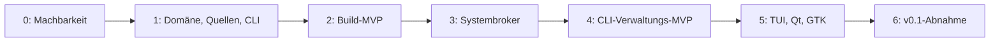

# Roadmap und Abnahme

Stand: 9. Oktober 2026. **Alle folgenden Phasen sind offen.** Die Veröffentlichung dieses Plans startet keine Implementierungsphase. Maßgeblich ist der [vollständige Plan](PLAN.md); Details der Nachweise stehen in der [Validierung](validation.md).

## Abhängigkeiten und Meilensteine

Ein Meilenstein setzt seine vorherigen Nachweise voraus. Ein blockierter Sicherheitsnachweis darf nicht durch eine vereinfachte unsichere Ausführung ersetzt werden. Es gibt bewusst keine Kalenderzusage vor Phase 0.

| Phase | Konkrete Arbeitspakete | Abnahme und Belege |
| --- | --- | --- |
| 0 | Zielstände festschreiben; Distributionszertifikate beschaffen; Sandbox prüfen; Header rekonstruieren; getrennte Modulsignierung und Paketierung erproben; Qt-/GTK-Brücken auf beiden Zielsystemen bauen | Versionierte Versuchsberichte, archivierte Eingaben und tatsächliche Ergebnisse. Ungeklärte Voraussetzungen sind Blocker. Unabhängiges Architekturreview vor Freigabe der privilegierten Umsetzung |
| 1 | Fachmodell und Zustände; Katalog und Kanalpolitik; geprüfter Schlüsselbund; begrenzte Downloads; sichere Extraktion; Rezeptablage; CLI und versioniertes JSON | Negative Quellen-/Archivtests, reproduzierbare Rezeptidentität, vollständige Konfigurationsdifferenzen und explizite Fehler |
| 2 | Authentifiziertes Rootfs; isolierter Worker; Ressourcen-/Abbruchsteuerung; Kbuild; getrennter Prüfprozess; Signierer; Header-/Paketexport; Reproduktion | Kernelimage, Module und praktisch verwendbare Header ohne Host-Bootänderung. Zwei frische Builds und öffentliche Signaturwiedergabe. **Build-MVP** |
| 3 | Versionierte Dienstschnittstellen; polkit und Terminalagent; Inventar; geschützte kurzlebige Pläne; Konkurrenzkontrolle; geschützter Transaktionsprozess und Journal | Autorisierungs-, Austausch-, Wiederholungs- und Konkurrenztests in VMs. Kein allgemeiner Root-Ausführungspfad |
| 4 | DKMS und initramfs; Installationsprüfung; Rückfallnachweis; GRUB-Pin; einmaliger Testboot; Beobachtung; Bestätigung; sichere Entfernung; Recovery | BIOS-/UEFI-Erfolgs- und Fehlerketten je Distribution einschließlich Hardresets und Teilinstallationen. **CLI-Verwaltungs-MVP** |
| 5 | TUI, Qt und GTK mit gemeinsamer Clientbibliothek; Zustände, Fortschritt und verständliche Fehler; Wiederverbindung; Tastaturbedienung und Barrierefreiheit; Deutsch/Englisch | Identische Kernaktionen und Sperrgründe; Clients schließen oder wechseln ohne Jobverlust; keine eigene Installationslogik im Frontend |
| 6 | Getrennte Anwendungspakete; Bedien-/Betriebsdokumentation; tägliche Versionsprüfung und ausdrücklich aktivierte Builds; vollständige Releaseprüfung | Alle Kriterien erfüllt, keine offenen kritischen Sicherheitsbefunde. **v0.1 mit vier Clients** |

## Bewusste Nichtziele von v0.1

- RC-Builds; Release Candidates können optional angezeigt werden.
- Installation bei aktiviertem oder ungeklärtem UEFI-Secure-Boot-Zustand.
- Andere Architekturen als amd64.
- Andere Bootloader, UKIs, verschlüsselte oder zunächst ungeprüfte Speicherlayouts.
- Beliebige importierte Pakete zur privilegierten Installation.
- CPU-spezifische Flags, Treiberreduktion und zusätzliche Patchsets als freigegebene Optimierung.
- Automatische Installation, automatische Bootübernahme oder automatischer Neustart.

## Ausbau nach eigener Freigabe

1. Vollständiger Secure-Boot-Pfad einschließlich separater Kernel-/Modulschlüssel, Einschreibung und tatsächlicher Bootprüfung.
2. Verifizierter RC-Buildpfad.
3. Fedora und Arch mit eigenen Paket-, Modul-, initramfs- und Bootnachweisen.
4. Weitere Speicherlayouts, Bootloader und Architekturen; openSUSE untersuchen.
5. Optional eingeschränkte individuelle Optimierungen mit dokumentiertem Hardwarevertrag und eigenen Tests, siehe [ADR 0008](adr/0008-config-profiles.md).

## Nachweisformat

Jeder zukünftige Prüfbericht benennt Quellrelease, vollständige Fingerprints, Rezeptidentität, Toolchain-/Rootfs-Identität, Plattform, genaue Operation, erwartetes und tatsächliches Ergebnis sowie relevante Logs und Artefakthashes. Fehlgeschlagene oder nicht ausgeführte Prüfungen bleiben sichtbar. Die dokumentierten Mindestprüfungen dürfen erst nach tatsächlicher Ausführung als bestanden markiert werden.
